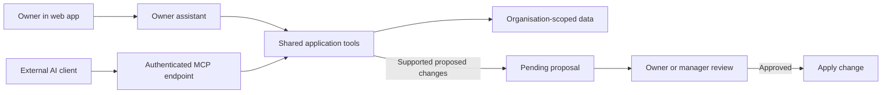
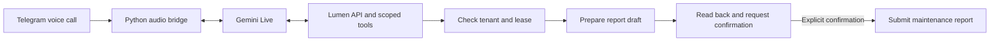

# Lumen Property Management System

[Back to portfolio](../README.md)

Lumen brings property, lease, rent and maintenance information into one system. I built workflows that help owners work with their records and help tenants report issues, while keeping access checks and review steps in the application.

**Stack:** Next.js and TypeScript for the web application; NestJS for the API; Supabase/PostgreSQL for data; Python, Telegram and Gemini Live for the voice bridge; WhatsApp and Stripe integrations for payment-related workflows.

## 1. Owner assistant and external tool access

An owner can ask questions about their portfolio using tools that retrieve relevant information. For supported record changes, the assistant creates a proposal for review instead of immediately applying the change. The owner or manager can inspect and decide on the proposal.

The web assistant uses shared tools directly inside the application. For external AI clients, Lumen also exposes those tools through an authenticated Model Context Protocol (MCP) endpoint. The server derives the organisation and permissions from the authenticated caller rather than letting the model choose an organisation.



### Implementation detail: claiming a pending proposal

This short excerpt from `apps/api/src/mcp/agent-proposals.service.ts` shows part of the update that claims a proposal for a decision. The conditions bind it to the caller's organisation and require a pending status. Claiming the row before applying the change helps prevent the same pending proposal from being applied twice; the surrounding code handles failures and returns the proposal to pending when appropriate.

```ts
.where(
  and(
    eq(schema.agentProposals.id, id),
    eq(schema.agentProposals.organizationId, auth.organizationId),
    eq(schema.agentProposals.status, 'pending'),
  ),
)
```

This excerpt shows one control in the proposal workflow. Other operations have their own permissions and behaviour.

## 2. Payment evidence and review

The platform integrates WhatsApp rent communication and Stripe payment evidence into a review workflow. External evidence is recorded for review, and the payment review service applies an approved change to the canonical rent payment record. This separates an incoming claim or external event from the landlord's reviewed record, and keeps the review and payment update together in a database transaction.

**Demonstration status:** The WhatsApp payment workflow was recorded during the service trial. The trial has expired, so that integration is not presented here as currently available for a live demonstration.

## 3. Tenant maintenance by Telegram voice

The Python bridge connects a Telegram voice call to the application and Gemini Live. The incoming maintenance flow checks the tenant's linked identity and current lease, gathers the issue, prepares a report draft and reads the details back. The design requires an explicit affirmative response after the readback before submitting the report. Existing tickets and troubleshooting information can also be considered during the conversation.



**Demonstration status:** Telegram voice calls have been tested. The design above describes the implemented workflow, not an independent claim that every end-to-end scenario has been verified in production.

## What this project demonstrates

- Designing a workflow across a web application, APIs, database and external messaging services.
- Keeping tenant and organisation context on the trusted application side of the assistant's tools.
- Separating proposals and incoming payment evidence from reviewed record changes.
- Building a voice interaction around a concrete task, including identity checks and a confirmation boundary.

The complete project repository is private. The code excerpt is intentionally limited; further architecture and demonstration details can be discussed during an interview.
