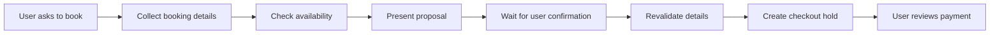
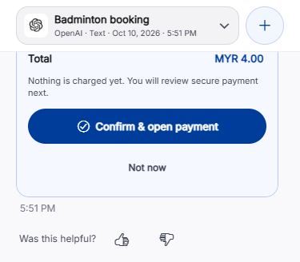
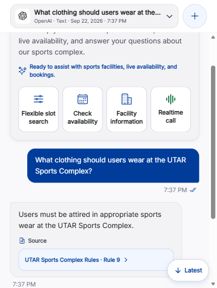

# UTAR Sport Facility

[Back to portfolio](../README.md)

This individual final-year project brings facility discovery, booking and related services into an application for UTAR sports facilities. I built an assistant to help users find information and navigate booking tasks, and evaluated parts of its memory and tool behaviour.

**Stack:** React Native and Expo; Firebase services; Python and FastAPI; LangGraph and LangChain; Langfuse hosted with Docker.

## 1. From a booking request to a checkout hold

The assistant collects the details needed for a booking, checks availability and presents a proposal. The workflow stops at that point so the user can review it. A later confirmation can trigger revalidation and creation of a checkout hold. A hold is not the same as a completed payment or confirmed booking; those outcomes depend on the application and payment workflow.



The graph has separate routes for these steps. For example, the following excerpt from `agent_service/workflow.py` defines the states and ends the graph after the proposal is built. Additional routing, validation and error handling are omitted here.

```python
builder = StateGraph(BookingGraphState)
builder.add_node("collect", self._node_collect)
builder.add_node("check_availability", self._node_check_availability)
builder.add_node("build_proposal", self._node_build_proposal)
builder.add_node("revalidate", self._node_revalidate)
builder.add_node("create_checkout_hold", self._node_create_checkout_hold)
# Routing setup omitted.
builder.add_edge("build_proposal", END)
```



*A captured booking interface showing the user's confirmation step before opening payment. Cropped to remove the profile photo; the screenshot does not show a completed payment.*

## 2. Answers grounded in facility information

The assistant can retrieve facility information and show a source alongside an answer. In the example below, a response about sportswear links to a specific sports complex rule. This gives the user a way to inspect the basis for the answer instead of relying solely on a generated response.



*Captured interface example showing an answer and its source. Cropped to remove the profile photo.*

## 3. Tool access and persistent memory

The agent uses registered application tools and a trusted request context. Tool arguments are validated, and tools with guards check whether a requested action is authorised before execution. This matters for actions and user-specific memory: a model's requested tool call alone should not determine whose data is accessed or whether a write is allowed.

For example, this excerpt from `agent_service/tools.py` shows the guard decision before the executor runs:

```python
if not verdict.allowed:
    return ToolResult.failure(
        verdict.code or "tool_not_authorized",
        verdict.message or "This action was not authorized by the current request.",
    )
return await tool.executor(parsed, context)
```

The preceding code builds the guard request from the validated arguments, context and invocation. The excerpt is one part of the application boundary, rather than a proof of complete security.

The assistant uses persistent user-scoped memory to retain relevant context. I evaluated how well it selected expected memories and whether controlled write requests respected the intended authorisation rules.

## 4. Evaluation and observability

I self-hosted Langfuse using Docker for traces and evaluation tracking. For a controlled offline memory evaluation:

| Measure | Result | What it measures |
| --- | --- | --- |
| Selection precision | 80.95% (17/21) | Relevant items among memories selected after the gate |
| Micro recall | 100% (17/17) | Expected items selected across the tested cases |
| Micro-F1 | 89.47% | Combined precision and recall from aggregate counts |
| Target-memory hit@3 | 16/16 positive queries | At least one expected memory in the ranker's top three |
| Memory-write authorisation | 14/14 checks | Decision and recorded write matched the expected outcome |

The 61-case held-out set covered several memory and context behaviours, including 25 selection queries. These are small controlled results for particular components, not a claim of overall agent accuracy, production readiness or real-world security. [See the calculation, scope and limitations](../evaluation/memory-selection.md).

## What this project demonstrates

- Translating a multi-step booking process into explicit states, user confirmation and revalidation.
- Connecting a mobile application to an assistant and authenticated application services.
- Showing source information to help users interpret retrieved answers.
- Measuring memory selection and authorisation with distinct metrics and acknowledging the limits of the test set.

The full repository and raw evaluation cases are private. Screenshots and short excerpts are shared to support a technical walkthrough.
